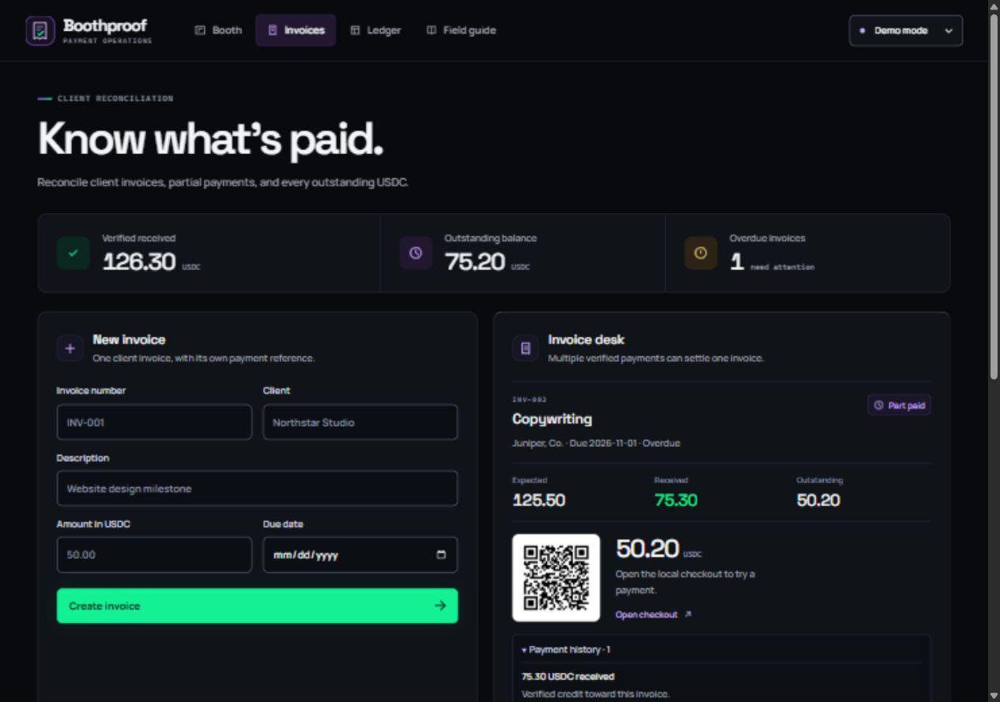

# Boothproof

**A USDC invoice desk on Solana that never guesses which invoice a payment belongs to.**

Built for freelancers and small studios: verify incoming payments, recover transfers with missing references, and keep an auditable invoice history.

Solo project · First time building on Solana · Intended Solana Hackathon (MLH) tracks: **Best Beginner Hack**, **DeFi**

[Run locally](#run-locally) · [Practice the flow](#practice-the-recovery-flow) · [Devnet acceptance record](DEVNET_ACCEPTANCE.md) · [Demo runbook](REHEARSAL.md)



## The problem

A client owes **50 USDC** and sends **30 USDC without the invoice reference**. The money arrives, but the transfer does not identify the invoice. Matching by amount, timing, or a familiar wallet address can put the payment against the wrong bill.

Boothproof separates two questions: **Did the payment arrive?** and **Which invoice should it pay?** On-chain evidence answers the first. A valid invoice reference or an explicit merchant decision answers the second.

## What happens in Boothproof

| Step | Payment handling | Invoice balance |
| --- | --- | --- |
| Client sends 30 USDC without a reference | Verify the transfer on Solana; keep it unallocated in **Recovery** | **0 received · 50 due** |
| Merchant reviews and assigns the payment | Apply the whole 30 USDC to the selected invoice and record the decision | **30 received · 20 due** |
| Client pays the remaining 20 USDC with the invoice reference | Verify and match automatically | **50 received · 0 due** |
| Either signature is submitted again, or the local app restarts | Reuse the saved payment record; never add credit twice | **50 received · 0 due** |

A reported invoice is only a suggestion until assignment. Invalid or unsupported transfers never become invoice credit.

## How it uses Solana

Solana is the payment and verification layer. Invoice records, recovery decisions, and audit history live in SQLite. **There is no custom on-chain program:** Boothproof uses the standard SPL Token Program, Solana Pay transfer requests, and Solana RPC.

| Solana capability | How Boothproof uses it |
| --- | --- |
| **USDC token transfers** | Payments move directly between the payer's and merchant's token accounts. The verifier checks the configured Devnet USDC mint, six-decimal amounts, and ownership of the destination account. |
| **Solana Pay reference keys** | Each invoice has a unique reference in its payment URL and QR code. Automatic matching requires that reference as a read-only, non-signing extra account on the final transfer instruction. An amount match alone is insufficient. |
| **Finalized transaction evidence** | The server retrieves the transaction through RPC and verifies success, recipient ownership, source debit, and destination credit. A screenshot or submitted signature alone is not proof of payment. |
| **Reference-based transaction lookup** | The monitor uses `getSignaturesForAddress` to discover referenced payments and `getTransaction` to verify them. A reference-free payment enters Recovery when its signature is reported; this is not a whole-wallet scanner. |
| **Wallet-controlled signing** | The payer approves in their own wallet. Boothproof never requests a private key or seed phrase and does not hold customer funds. |

The reference mechanism follows the [Solana Pay transfer-request specification](https://solana.com/docs/tools/solana-pay/specification/version1). Receiving-wallet and token-account handling follow Solana's [payment conventions](https://solana.com/docs/payments/accept-payments).

Small payment fees also suit deposits and partial invoice payments. In the recorded Devnet run, each transfer cost **80,000 lamports (0.00008 test SOL)**, including a priority fee. This is an observed test-network fee, not a guaranteed price; Solana fees include a base fee and an optional [priority fee](https://solana.com/docs/core/fees/fee-structure).

## Real Devnet proof

The [acceptance record](DEVNET_ACCEPTANCE.md) documents the complete two-wallet flow in Phantom on **November 7, 2026 (IST)**: an unreferenced 30 USDC payment, manual assignment, and a referenced 20 USDC payment that settled the invoice. These are real Devnet transactions using test tokens, separate from the simulated demo.

| Payment | Role in the flow | Public proof |
| --- | --- | --- |
| **30 USDC** | Verified without a reference; credited only after merchant assignment | [View finalized transaction](https://explorer.solana.com/tx/2gGmc7KyTJG3abNie78tRgT5U6S6w6k3YgPuYmzTzPi48kPJ3JMurhs1kgrvN3ceVeRKyzS7eyAbvxW7s3eqpnfY?cluster=devnet) |
| **20 USDC** | Matched by invoice reference; settled the remaining balance | [View finalized transaction](https://explorer.solana.com/tx/3rspW6Tdq8T3U87jjgmgv85pxSu6sFUbPun3V1YVPZ7Cv45H9kG1rwXvumafrz6UgtnyipUChqYWCyrm4RYEhPuw?cluster=devnet) |

Both signature replays and an actual local restart preserved the ledger and history export. Wallet addresses, slots, fees, and observed results are recorded in [DEVNET_ACCEPTANCE.md](DEVNET_ACCEPTANCE.md).

## Run locally

Requires **Node.js 24+**. No `npm install` or build step is needed; the QR library and fonts are included in the repository.

```bash
git clone https://github.com/Sanskar-Dwivedi/BoothProof.git
cd BoothProof
npm start
```

Open [Invoices](http://127.0.0.1:4173/#invoices). On Windows PowerShell, use `npm.cmd` if script execution policy blocks `npm`.

Local mode binds to **127.0.0.1** and supports one operator and one receiving wallet. Customer checkout is a filtered local view, **not authentication**. Do not expose the local Devnet desk publicly.

Data is saved in `data/boothproof.sqlite`. Stop an older application process before the first upgraded startup, including copies on another port. The main entrypoint checks its port before opening the database, and the new store holds an exclusive process lock.

```powershell
npm.cmd test
npm.cmd run devnet:check
```

The test suite currently passes **50 tests**. It uses isolated databases, local HTTP servers, and controlled RPC responses; it does not require an external network. The Devnet check contacts the configured network and checks the finalized slot and canonical USDC mint; it does not exercise a payment or move funds.

## Practice the recovery flow

Try the core flow in about two minutes, with **no wallet or test tokens required**. New databases contain three invoice examples: an unpaid 50 USDC invoice with a fixed 30 USDC deposit, a partially paid invoice, and an overdue invoice with an excluded wrong-token attempt. Existing invoices are never overwritten. Legacy booth examples and saved booth routes remain available through Guide.

1. In **Demo mode**, select the 50 USDC invoice. Open **Practice invoice payments · offline** and choose **Practice reference-free 30 USDC**.
2. The transfer is verified, but received remains zero. Open **Recovery** to inspect its exact amount, source wallet, recipient, provenance, times, and suggested invoice.
3. Choose **Assign to invoice**, select the invoice, and review received before/after, the remaining balance, and any excess. Confirm the assignment.
4. Open the customer statement. Received is 30 USDC and remaining is 20 USDC. The deposit has already been met. Choose **Simulate remaining balance**.
5. Report either saved signature through **I already paid**, or repeat the practice action. Received stays 50 USDC. Restart and open the same statement to inspect saved evidence.

**Demo payments are simulated**, with fake signatures generated by deterministic server fixtures. Repeating an action reuses its signature. Local demo data persists in SQLite. The Render-hosted demo configuration instead uses an in-memory ledger, disables Devnet payments and background monitoring, and resets when the server restarts.

The offline QA artifacts (`workspace-recovery-demo-simulated.webm`, `workspace-simulated-*`, and `workspace-focused-*`) are separate from the live Devnet artifacts (`devnet-live-*` and `devnet-acceptance-*`). Recordings and evidence files under `output/` are local artifacts excluded from Git; a fresh clone does not include them. The [acceptance record](DEVNET_ACCEPTANCE.md) and public Explorer links above remain available.

<details>
<summary><strong>Merchant behavior, accounting rules, and API details</strong></summary>

## Merchant and customer behavior

- **Invoices:** compact summary and attention links above a register/desk workspace, approximately 40%/60% at desktop widths. Native dialogs hold New invoice and Import CSV. Expected, received, remaining, signature verification, and a verified-but-unallocated report action appear before detailed evidence/history. At 360px, use the invoice picker and View details. Financial states are unpaid, partial, paid, and overpaid; review state is separate.
- **Recovery:** verified incoming transfers await explicit assignment. A reported invoice is a suggestion. The source wallet is not verified client identity. The full payment goes to one invoice using the same mode and receiving wallet. Amount, timing, and client names never trigger automatic matching.
- **Reversal:** a merchant can reverse a manual assignment with a reason. Credit is removed; the transfer and history remain. Reference and legacy assignments cannot be redirected or reversed. This application does not execute refunds.
- **Review:** acknowledgment requires a note and changes only the attention flag. Invalid transfers remain excluded. Excess stays visible after acknowledgment. New contributing payment evidence reopens excess review; a reversal removing excess clears it.
- **Customer checkout:** shows invoice details, balances, receiving wallet, payment options, relevant verified payments, safe recovery status, and monitoring. It excludes merchant decision notes, audit actions, and other invoices. A recovered payment awaiting allocation does not reduce the balance; the customer is told to wait before paying again.

Polling preserves selection, open details, signature drafts, and decision notes. Durable per-invoice revisions prevent a delayed response from restoring an earlier balance or obsolete payment request, including after a reversal. Assignment captures both the payment version and the target invoice's financial revision. A changed target requires **Refresh preview** and renewed confirmation; an uncertain response retries the exact saved decision/request ID. Reporting an already-unallocated signature against a different invoice returns an explicit conflict. Its first suggestion remains nonbinding for the merchant's actual assignment.

Allocation API clients must send `expected_invoice_revision` as the decimal string shown in `order.invoice.financial_revision`, alongside `request_id`, `expected_version`, and `invoice_id`. The store checks both versions atomically; a changed target returns `409 STALE_INVOICE` and a safe current customer projection. Review-only changes do not invalidate a financial preview. Legacy customer signature entry remains supported with the same filtered response.

Amounts are calculated with integer units and `BigInt`. Invoice and deposit creation accept 0.01–9,999.99 USDC with at most two decimals; the deposit must be below the total. Verified payments and remainders retain all six decimals. A deposit is a **cumulative fixed target**, reduced by all active payments, including recovered payments. The server generates current deposit/balance requests using the same reference. An older copied URL can still produce an excess payment, which remains visible.

Five-column CSV imports remain `invoice_number,client,title,amount,due_date`. Imports are atomic, at most 100 rows, and identical imports are skipped. Imported invoices have no deposit. Statement exports preserve existing columns and append deposit/review information. Per-invoice history CSV distinguishes verified transfers, assignments, reversals, and acknowledgments, and escapes spreadsheet formulas in user text.

</details>

## Solana Devnet

Copy `.env.example` to `.env` and set `MERCHANT_WALLET` to the receiving wallet's **public address**, not its token-account address. Optionally set a trusted HTTPS `SOLANA_RPC_URL`. Restart and choose **Solana Devnet**.

Use separate payer and receiver test wallets. The payer must have test SOL for fees and standard Devnet USDC. The user signs in their own wallet; Boothproof never requests private keys or seed phrases. Select Devnet in the wallet before opening a Solana Pay request. Wallet interoperability must be demonstrated with actual signed transactions; connectivity alone does not confirm it.

The isolated live run passed. Phantom in Brave submitted a reference-free 30 USDC transfer and the referenced 20 USDC remainder as finalized legacy transactions. Boothproof preserved the unallocated state until merchant assignment and then settled the invoice by reference. Both signature replays and an actual restart preserved the ledger and CSV. [Acceptance record](DEVNET_ACCEPTANCE.md)

For the configured acceptance invoice, the customer checkout links to **Send 30 USDC without a reference** and **Review in Phantom**. These open the same wallet review helper used for the original approvals. The generic Solana Pay URI remains a separate option for compatible wallets and still needs a Brave compatibility test.

Reopen the settled acceptance invoice from its isolated database.

```powershell
node --env-file-if-exists=.env scripts/devnet-acceptance.js serve
# Separate terminal for read-only video preview
node scripts/review-artifacts.js
```

Open Invoices on port 4175 and select **Solana Devnet**. The wallet review page on port 4177 now shows settlement. During a live run it hides submitted actions and advances to the referenced remainder after merchant assignment. [Settled customer statement](http://127.0.0.1:4175/pay/b02ea657-ca79-4c80-a8ce-f09d51cfcac8) · [Phantom review page](http://127.0.0.1:4177/)

Supported verification:

- Finalized successful **legacy or v0** transactions, including resolved lookup-table addresses.
- One direct top-level standard Token Program `Transfer` or `TransferChecked`.
- Account creation, compute-budget instructions, and memos around an unreferenced transfer; newly created destination token accounts with creation evidence.
- Canonical Devnet USDC, six decimals, destination ownership matching the saved receiving wallet, exact destination net credit, consistent source ownership/debit, and a non-self transfer.
- A known reference binds only as a read-only, non-signing extra account on the final transfer instruction. A malformed known reference cannot fall back to manual recovery. A reference belonging to another order conflicts.

Unsupported: CPI-only payments, multiple transfers, delegated or multisig forms outside the parser, Token-2022, missing ownership/balance evidence, unknown companion programs, and transaction versions above v0. Unsupported/rejected transfers create no credit. A `null` finalized lookup means **not found at finalized commitment**, not proof that the transaction does not exist. Retry pending signatures without paying again.

No mainnet, whole-wallet discovery, payment splitting, authentication, multiple merchants, refunds, swaps, subscriptions, AI features, or custom programs are included.

## Lessons from building on Solana

- **A wallet address is not a token account.** USDC sits in a token account, so verification must establish who owns the destination, as well as which mint it holds.
- **Not found does not mean nonexistent.** A finalized lookup can return `null` before a payment is available at that commitment. Boothproof keeps that signature pending for retry instead of telling the customer to pay again.
- **A fee quote can change before signing.** The recorded requests quoted 5,000 lamports before wallet adjustments; each signed transfer cost 80,000 lamports with the priority fee included.
- **Real wallet behavior belongs in tests.** Phantom repeated the signing authority in a direct transfer. The verifier handles that form, and a regression test ensures it remains unallocated without an invoice reference.
- **Connecting a wallet is not an end-to-end payment test.** The acceptance run checked signed transfers, finalized evidence, allocation, duplicate submissions, and restart persistence.

## Built with and disclosure

- **Application:** Node.js 24+, built-in SQLite, plain JavaScript, HTML, and CSS. Amounts use integer token units and `BigInt`.
- **Solana integration:** Devnet RPC, standard SPL Token transfers, Solana Pay URLs and QR codes, and a local Phantom review helper using Wallet Standard.
- **Interface:** vendored `qrcode`, self-hosted Space Grotesk and Manrope fonts (OFL), and native adaptations of Spectrum UI patterns (Apache 2.0). See [design attributions](design/README.md).
- **Verification and hosting:** Node's built-in test runner, Playwright browser checks, and a Render-specific simulated demo configuration.
- **Project context:** solo, first time building on Solana; intended tracks are Best Beginner Hack and DeFi. The repository records pre-event rehearsal work. Submission eligibility and permission to reuse that work are **unconfirmed**; no organizer approval is recorded.
- **AI assistance:** AI coding assistants were used for code, tests, and documentation. This README revision used OpenAI Codex; the repository does not establish a complete list of earlier assistants.

<details>
<summary><strong>Operations, migration, and detailed verification</strong></summary>

## Background checking

Monitoring runs in the Node process with all browser tabs closed:

- Unpaid/partial invoices: every 10 seconds.
- Paid/overpaid invoices: every 60 seconds for 24 hours after their latest allocation change; manual checking stays available afterward.
- Unfinished scans resume across restarts and outside the usual monitoring window. Newly migrated invoices get a catch-up scan.
- History pages contain 50 signatures. Saved page dispositions, pagination cursors, scan heads, and completed watermarks prevent skipped entries. A temporary null transaction stays pending. A missing prior watermark reports a history gap and preserves the old completion boundary.
- Each job has a 10-second budget. Work rotates fairly among invoices. Failures back off 10, 20, 40, then 60 seconds. Actual RPC calls are capped at four, with shared transaction lookups and overlapping checks coalesced.

The interface shows last attempt, last complete scan, catching-up status, and errors. An incomplete/stale scan is not labeled current. Browser polling reads saved state every five seconds and preserves typed forms; only an explicit check performs verification.

## Migration and recovery

Schema version is `PRAGMA user_version = 1`. Before changing a legacy file-backed database, startup creates a timestamped backup in **`data/backups/` using SQLite `VACUUM INTO`**. Backup failure aborts startup. Schema changes/backfill occur in one transaction; the migration compares every invoice's expected, received, remaining, and excess amounts, preserves legacy orders/evidence/accepted receipt identities, and checks integrity and foreign keys. No RPC calls run in migration. Repeated startup does not rerun migration. A newer unsupported schema stops startup.

Legacy accepted and short/additional booth payments are reserved in the shared registry with `legacy` provenance and their original associations. Rejected evidence becomes review cases for invoices and never becomes verified credit. Source accounts, owners, and historical chain time not previously stored remain unknown.

To restore a backup:

1. Stop Boothproof and any older copy. Confirm it is no longer running.
2. Preserve the current database **and its `-wal`/`-shm` companions together** under archival names. Keep these files available for investigation; never copy only the main file from a live WAL database.
3. Copy the chosen timestamped backup from `data/backups/` to `data/boothproof.sqlite`. Ensure no old WAL/SHM files remain under the active database's companion filenames.
4. Start the current application. A pre-upgrade backup will migrate again, including fresh validation and a new backup.

A stale lock from a dead process is reclaimed automatically. If its recorded PID belongs to a live process, inspect that process before removing the lock. Do not force a schema version backward. Running old application code against the new registry can show incorrect balances; reverting code requires a matching pre-upgrade database backup.

## Verification and handoff

See [REHEARSAL.md](REHEARSAL.md) for the two-minute demonstration and actual Devnet acceptance steps, and [IMPLEMENTATION.md](IMPLEMENTATION.md) for changed files and recorded verification.

The offline browser rehearsal uses `output/playwright/qa.sqlite` for its Demo fixtures and restart checks.

```powershell
node scripts/browser-qa-server.js
# In another terminal, with Playwright CLI and a browser installed:
playwright-cli -s=boothproof open http://127.0.0.1:4174 --browser chrome
playwright-cli -s=boothproof run-code --filename scripts/browser-workflow.js
```

Stop the rehearsal server before starting the review server on the same port. Review mode uses an in-memory ledger and mock RPC.

```powershell
node scripts/browser-qa-server.js --review
# In another terminal:
playwright-cli -s=boothproof-review open http://127.0.0.1:4174 --browser chrome
playwright-cli -s=boothproof-review run-code --filename scripts/browser-review-regressions.js
playwright-cli -s=boothproof-review close
```

Stop the review server with Ctrl+C when the checks finish. The recorded Chrome checks verified payment-option ordering in both directions, stale errors and loading state, delayed responses after settlement, stale previews, recovery conflicts, and desktop and 360px layouts. `npm.cmd test` was rerun on November 8, 2026 (IST): **50 passed, 0 failed**, including recovery arriving during unsigned wallet preparation.

The primary hackathon recording shows the checkout-linked Phantom flow in one take. It re-verifies the two earlier finalized Devnet receipts with live RPC in a fresh replay ledger. [42-second hackathon take](output/playwright/hackathon-one-take-devnet-replay.webm) · [Runbook](REHEARSAL.md) · [Offline fallback](output/playwright/workspace-recovery-demo-simulated.webm)

Technical references: [Solana Pay binding specification](https://solana.com/docs/tools/solana-pay/specification/version1), [transaction metadata](https://solana.com/docs/rpc/json-structures), [finalized transaction lookup](https://solana.com/docs/rpc/http/gettransaction), [paginated reference history](https://solana.com/docs/rpc/http/getsignaturesforaddress), [official Solana development skill and references](https://github.com/solana-foundation/solana-dev-skill/tree/main/skills/solana-dev), [Phantom legacy signing](https://docs.phantom.com/solana/sending-a-transaction), [Phantom v0 signing](https://docs.phantom.com/solana/sending-a-transaction-1), [Phantom test networks](https://help.phantom.com/articles/use-testnets-in-phantom-5997313271699), [SQLite consistent backups](https://sqlite.org/lang_vacuum.html). Existing fonts, theme, QR library, and [design attributions](design/README.md) are retained.

</details>
